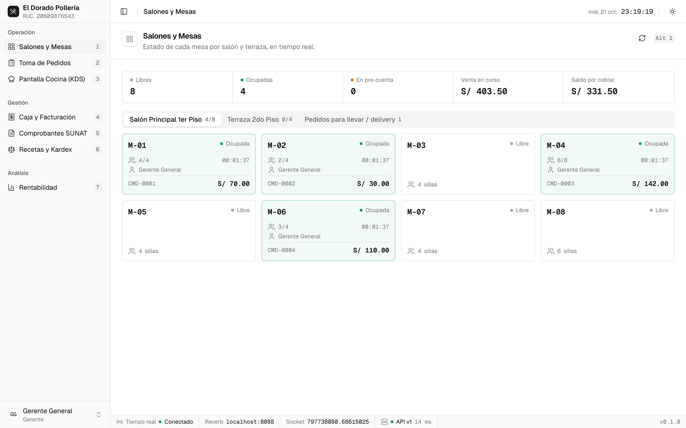
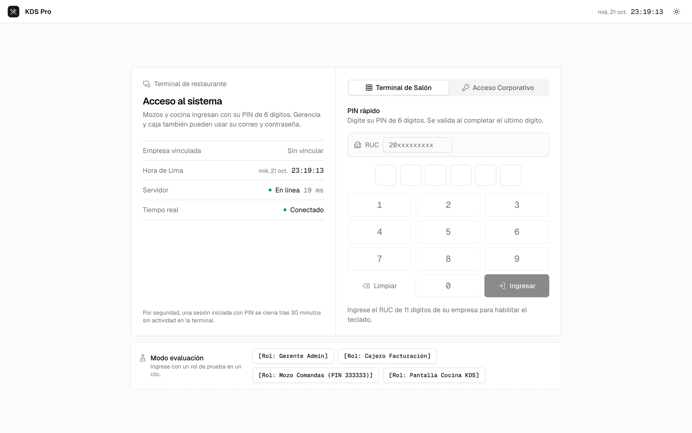
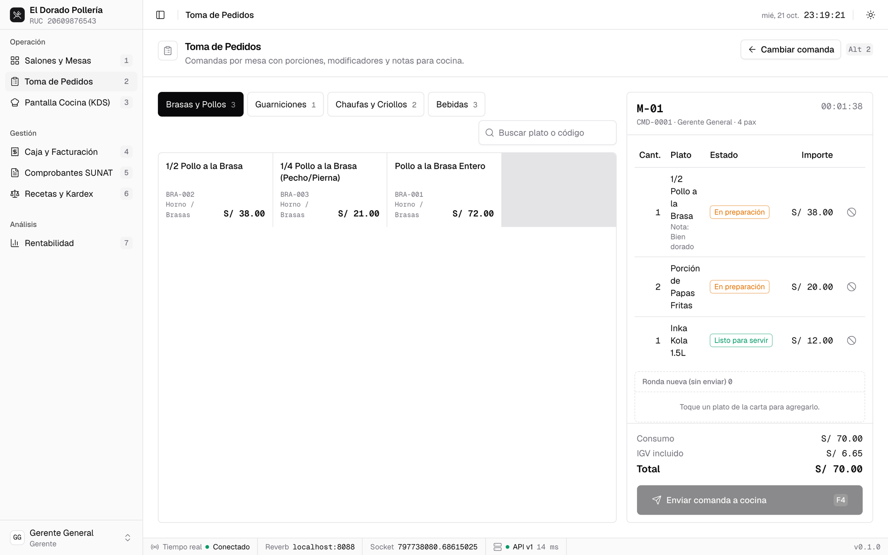
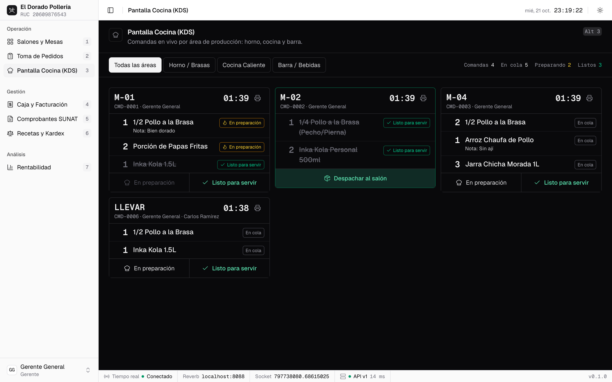
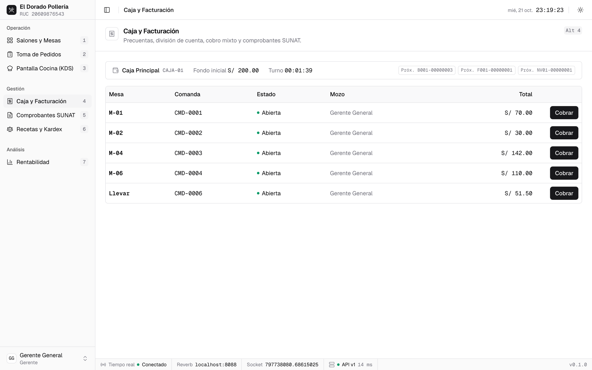
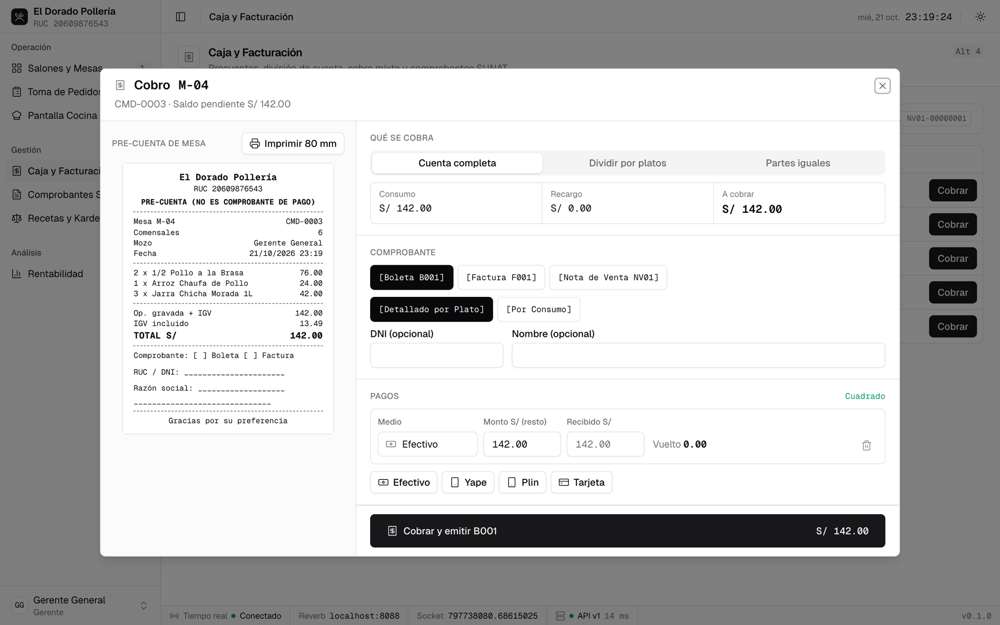
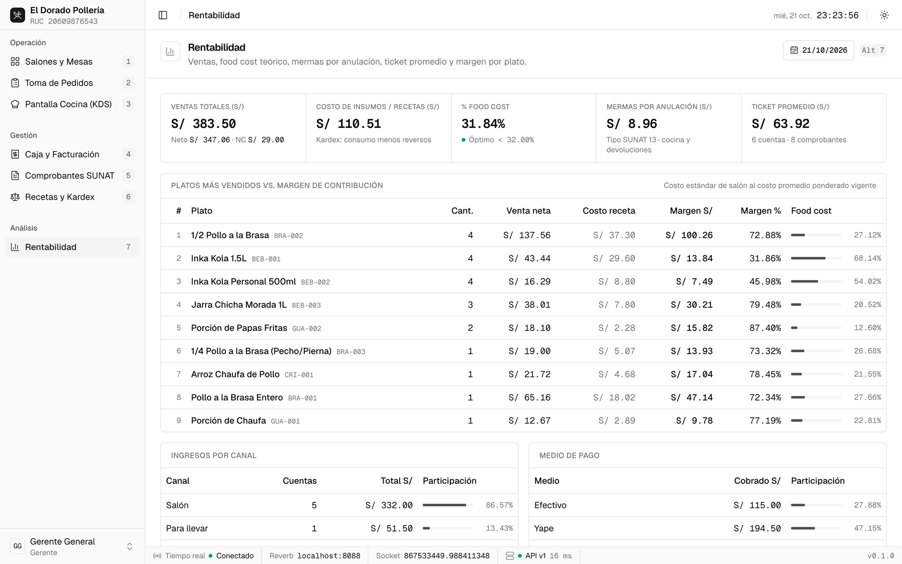
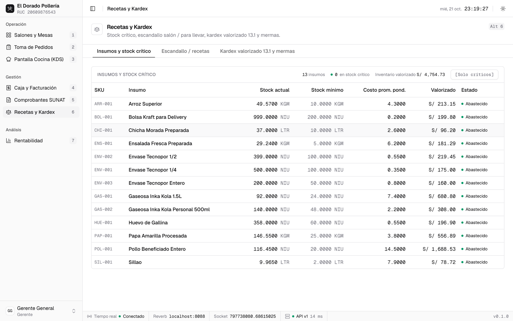
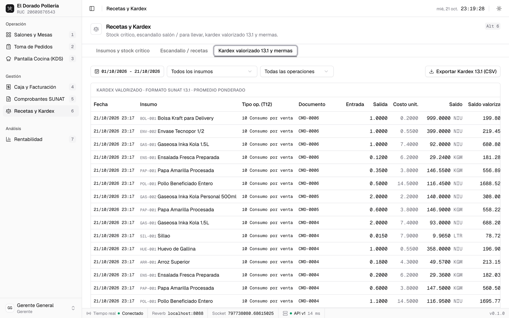
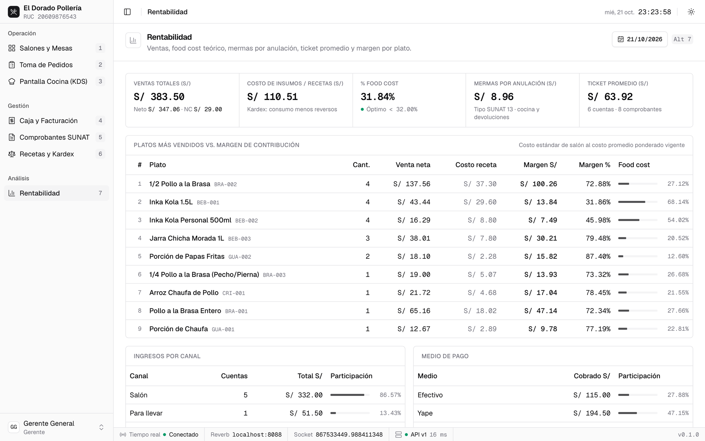

# Restaurante KDS Pro — ERP Gastronómico, Comandas en Tiempo Real y Facturación SUNAT UBL 2.1

Sistema empresarial de gestión gastronómica que diseñé para salones, pollerías y restaurantes en Perú.
Incluye control de concurrencia en mesas, comandas instantáneas vía WebSockets (Laravel Reverb), escandallo
fraccionario de recetas (Kardex Valorizado Formato 13.1), división de cuentas (*Split Bill*) y facturación
electrónica SUNAT UBL 2.1 (Boletas, Facturas y Notas de Crédito, modalidad Detallada o Por Consumo, soporte
IGV MYPE y afectaciones gravadas, exoneradas e inafectas).



Lo construí como un monorepo desacoplado: una API REST versionada (`backend/`) y una SPA (`frontend/`) que se
comunican solo por HTTP (JSON) y WebSockets. Cada operación que toca una mesa, una comanda o el stock corre en
una transacción con bloqueo pesimista (`SELECT ... FOR UPDATE`) y un orden global de bloqueo, de modo que dos
mozos nunca abren la misma mesa ni descuentan dos veces el mismo insumo. Las cantidades del escandallo se
guardan en `NUMERIC(14,4)` y se calculan con BCMath, sin aritmética de punto flotante.

## Stack Tecnológico

| Capa | Tecnología |
| --- | --- |
| Backend | PHP 8.4, Laravel 13 (API-Only), Sanctum (sesión SPA por cookie), Spatie Permission (roles por empresa) |
| Base de datos | PostgreSQL 16 |
| Caché, sesiones y colas | Redis 7 |
| Tiempo real | Laravel Reverb (WebSockets) y Laravel Echo |
| Facturación electrónica | Greenter: XML UBL 2.1 firmado, envío a SUNAT y lectura del CDR |
| Frontend | React 19, TypeScript 5.9, Vite, Tailwind CSS, shadcn/ui, TanStack Query, Zustand, Zod |
| Gestores de paquetes | Composer y `pnpm` |
| Infraestructura | Docker Compose: Nginx, PHP-FPM, worker de colas, Reverb, PostgreSQL y Redis |

## Inicio rápido

Con Docker instalado, un solo comando levanta el sistema completo con una pollería de demostración:

```bash
git clone https://github.com/luid-dev/restaurante-kds-pro.git
cd restaurante-kds-pro
./setup-demo.sh
```

Abra `http://localhost:8088` e ingrese con el botón **[Rol: Gerente Admin]**. Para una actualización posterior
basta `docker compose up -d --build`.

La guía completa está en **[INSTALL.md](INSTALL.md)**: requisitos, instalación con Docker, entorno de desarrollo
local paso a paso, recorrido de prueba, suite de pruebas y solución de problemas frecuentes (por ejemplo, la
pantalla de acceso con "Servidor: Sin respuesta").

### Credenciales de prueba integradas

Empresa demo **El Dorado Pollería**, RUC `20609876543`, contraseña común `Password123!`. El ingreso rápido por
PIN pide el RUC y el PIN de 6 dígitos del usuario.

| Rol | Correo | PIN | Módulos |
| --- | --- | --- | --- |
| Admin (Gerente) | `admin@restaurante.pe` | `111111` | Todos |
| Cajero | `caja@restaurante.pe` | `222222` | Salones, pedidos, caja, comprobantes y rentabilidad |
| Mozo | `mozo@restaurante.pe` | `333333` | Salones y toma de pedidos |
| Cocina KDS | `cocina@restaurante.pe` | `444444` | Pantalla de cocina |

Estas cuentas solo existen en entornos locales o de demostración (`APP_DEMO_MODE=true`).

## Recorrido del sistema

Cada módulo se abre desde la barra lateral o con `Alt` + número, y solo aparece si el rol tiene el permiso
correspondiente. El backend vuelve a exigir ese permiso en cada petición.

### 1. Acceso dual por PIN o credenciales



La terminal del salón se vincula a la empresa con su RUC y luego cada usuario entra con su PIN de 6 dígitos;
gerencia y caja también pueden usar correo y contraseña. El panel izquierdo muestra en vivo el estado del
servidor y de la conexión en tiempo real. Ambos métodos crean una sesión por cookie (ningún token queda en
JavaScript) y la sesión por PIN se cierra tras 30 minutos de inactividad.

### 2. Salones y mesas (`Alt+1`)

El plano de la captura superior muestra cada mesa por salón con su estado (libre, ocupada, en pre-cuenta),
comensales, mozo, tiempo transcurrido y consumo. Los indicadores de cabecera resumen mesas libres, ocupadas, venta
en curso y saldo por cobrar. Al tocar una mesa libre se abre con su comanda; si dos mozos lo intentan a la vez, el
bloqueo pesimista deja pasar solo al primero. Desde aquí también se mueven cuentas entre mesas o se unen.

### 3. Toma de pedidos (`Alt+2`)



El mozo elige platos de la carta por categoría o con el buscador, agrega modificadores y notas para cocina, y
envía la ronda con **Enviar comanda a cocina** (`F4`). En ese instante se descuentan del stock los insumos de
cada receta. El ticket lateral muestra el estado de cada plato en cocina y permite anularlo con un motivo
auditado: si ya estaba en preparación, el insumo se registra como merma.

### 4. Pantalla de cocina, KDS (`Alt+3`)



Las comandas llegan por WebSocket sin recargar, agrupadas por área de producción (Horno / Brasas, Cocina Caliente
y Barra / Bebidas) y en orden de llegada. Cocina avanza cada plato a **En preparación** y **Listo para servir**;
cuando toda la ronda está lista aparece **Despachar al salón**. El cronómetro de cada ticket se resalta a los
10 minutos y marca demora a los 15, y cada ticket se puede imprimir en formato térmico.

### 5. Caja y facturación (`Alt+4`)



El cajero abre su turno con un fondo inicial y ve todas las cuentas abiertas con el próximo correlativo de cada
serie (`B001`, `F001`, `NV01`). Al pulsar **Cobrar** se abre el cobro de la mesa:



A la izquierda está la pre-cuenta en formato de ticket de 80 mm. A la derecha se elige qué se cobra (cuenta
completa, división por platos o partes iguales), el comprobante (Boleta, Factura con RUC o Nota de Venta), la
modalidad **Detallada** o **Por Consumo**, y uno o varios medios de pago (efectivo con cálculo de vuelto, Yape,
Plin y tarjeta). El XML UBL 2.1 se firma dentro de la misma transacción del cobro.

### 6. Comprobantes SUNAT (`Alt+5`)



Historial de facturas, boletas, notas de venta y notas de crédito con filtros por tipo, fecha y RUC. Cada
comprobante permite ver el ticket, descargar el XML firmado y el CDR de SUNAT, y emitir una nota de crédito
(`FC01` / `BC01`) que queda vinculada al documento original. El botón **SIRE RVIE** exporta el archivo de
reemplazo del Registro de Ventas del periodo tributario.

### 7. Recetas y kardex (`Alt+6`)



La pestaña de insumos muestra el stock actual contra el mínimo, el costo promedio ponderado y el inventario
valorizado, con filtro de stock crítico. La pestaña de escandallo muestra cuánto de cada insumo lleva un plato en
salón y para llevar (envases incluidos).



El kardex valorizado Formato 13.1 registra cada entrada y salida con su tipo de operación SUNAT (tabla 12), el
documento de origen y el saldo valorizado, y se exporta a CSV. Las anulaciones de platos en preparación y las
devoluciones aparecen como mermas tipo 13.

### 8. Rentabilidad (`Alt+7`)



Tablero de gerencia por rango de fechas: venta total y neta (descontadas las notas de crédito), costo teórico de
insumos según el kardex, porcentaje de food cost frente al objetivo de 32 %, mermas por anulación, ticket
promedio, margen de contribución por plato e ingresos por canal y por medio de pago.

## Adaptación Empresarial

¿Desea implementar este sistema en su restaurante, pollería o cadena de establecimientos? El software es
completamente adaptable a sus requerimientos operativos (múltiples salones, impresoras térmicas de cocina,
integración con balanzas o pasarelas de pago). Contácteme para coordinar la personalización y puesta en marcha
para su empresa.

- Correo: _(por completar)_
- Perfil profesional o sitio web: _(por completar)_
